# GoblinFlip v0.2

[](https://github.com/EvilSpaceGoblins/GoblinFlip/releases/tag/v0.2)
[]()
[]()
[]()
[](LICENSE)
[](https://www.curseforge.com/wow/addons/auctioneer-forever)
[](https://www.curseforge.com/wow/addons/disenchantbuddy)
[]()

---

> **Every copper counts.** — *GoblinFlip motto*

A World of Warcraft: **Forever (1.60.1)** auction-house addon that helps you find **vendor flips** and estimate **disenchant flips** — complete with scan → discover → validate → buy → mail/merchant reconcile → ledger workflow.

---

## 🎯 What Does It Actually Do?

| You See on AH | You Do | You Get | Profit |
|:---|:---:|:---:|:---:|
| 🧵 Linen Cloth ×20 for **50s** | Buy it, run to vendor | **75s** (3s 75c × 20) | **+25s** ✅ |
| 💎 Green BoE for **5g** | Buy it, disenchant | ~8g in mats (est.) | **~+3g** 🎲 |
| ⚔️ Epic BoE for **500g** | Buy it, disenchant | ~400g in mats (est.) | **-100g** ❌ |

**Vendor flips = guaranteed math.**  
**Disenchant flips = estimated averages (RNG-based).**

---

## ✨ Features at a Glance

| Category | Feature | Status |
|:---|:---|:---:|
| **Scanning** | Auctionator `Get All` integration | ✅ |
| | Native replicate scan (standalone mode) | ✅ |
| **Analysis** | Vendor flips (exact profit) | ✅ |
| | Disenchant estimates (internal or DisenchantBuddy) | ✅ |
| | Market detection (Horde/Ally/Neutral) | ✅ |
| **Execution** | One-submission-at-a-time guarantee | ✅ |
| | Live quote before every purchase | ✅ |
| | Explicit user confirmation required | ✅ |
| **Tracking** | Full transaction ledger | ✅ |
| | Session budget (persists `/reload`) | ✅ |
| | History (7 days / 10 snapshots) | ✅ |
| **UX** | In-game dependency check | ✅ |
| | Sound alerts (opt-in, rate-limited) | ✅ |
| | Tooltip & context menu integration | ✅ |
| | **Standalone mode (zero dependencies)** | ✅ |

---

## 📦 Installation

```bash
# 1. Download latest release
# https://github.com/EvilSpaceGoblins/GoblinFlip/releases/latest

# 2. Unzip to your WoW Forever AddOns folder
unzip GoblinFlip.zip -d "/Applications/World of Warcraft/_forever_/Interface/AddOns/"

# 3. Log in, type:
/gf help
```

### Requirements

| Dependency | Required? | Purpose | Download |
|:---|:---:|:---|:---|
| **Auctionator** | ⭕ Optional* | Full-scan data source (faster) | [CurseForge](https://www.curseforge.com/wow/addons/auctioneer-forever) |
| **DisenchantBuddy** | ⭕ Optional* | Disenchant value estimates | [CurseForge](https://www.curseforge.com/wow/addons/disenchantbuddy) |
| **LibStub** | 📦 Embedded | Library loader | Included |
| **LibAHTab** | 📦 Embedded | AH tab integration | Included |

> **\*Optional in Standalone Mode** — Enable `standaloneMode` in settings to use native scan + internal DE data with **zero external dependencies**.

---

### 🎯 Standalone Mode (Zero Dependencies)

GoblinFlip includes a **Standalone Mode** that works completely without Auctionator or DisenchantBuddy:

```lua
-- Enable in settings (or via slash command):
/gf settings standaloneMode true
```

| Feature | With Auctionator | Standalone Mode |
|:---|:---|:---|
| **Full scan** | Auctionator `Get All` (fast, ~30s) | Native `ReplicateItems` (slower, ~2-5 min) |
| **Live search** | Native (same) | Native (same) |
| **DE estimates** | DisenchantBuddy API | Internal tables (Classic → MoP) |
| **Dependencies** | Auctionator required | **Zero external deps** |

**When to use Standalone Mode:**
- You don't want to install Auctionator
- You're on a fresh Forever client
- You prefer zero-dependency addons

**Trade-offs:** Native scan is slower and can disconnect if the server throttles. Auctionator is recommended for regular use.

---

## 🚀 Quick Start

### With Auctionator (Recommended)
```text
1. Open Auction House
2. Click Auctionator's "Get All" button (manual scan trigger)
3. Wait for scan to complete
4. Browse "Vendor Flips" tab — sorted by profit
5. Click an opportunity → "Buy Next" → Confirm
6. Check Ledger for results
```

### Standalone Mode (No Auctionator)
```text
1. Enable: /gf settings standaloneMode true
2. Open Auction House
3. Click "Scan" in GoblinFlip tab
4. Wait for native scan (2-5 minutes)
5. Browse opportunities
6. Purchase & track in Ledger
```

### Slash Commands
| Command | Description |
|:---|:---|
| `/gf scan` | Start a new scan |
| `/gf help` | Show all commands |
| `/gf settings` | Open settings panel |
| `/gf budget` | Reset session budget |
| `/gf reset` | **⚠️ Wipes all data** |

---

## 🧠 How It Works (Under the Hood)

```mermaid
graph LR
    A[Auctionator Get All] --> B[ScanNormalizer]
    B --> C[ItemInfo: C_Item.GetItemInfo]
    C --> D[VendorStrategy: profit = qty×vendor - buyout]
    D --> E[ProfitEngine: filter/sort/group]
    E --> F[OpportunityIndex: snapshot]
    F --> G[UI: Vendor Flips tab]
    G --> H[LiveMarket: live quote]
    H --> I[PurchaseManager: submit + confirm]
    I --> J[Ledger: track to disposal]
```



### Vendor Flip Math (Exact)
```
buyoutTotal = what you pay on AH (stack price)
vendorUnit  = C_Item.GetItemInfo(item).sellPrice  -- return #11
proceeds    = quantity × vendorUnit
profit      = proceeds - buyoutTotal
ROI         = 100 × profit / buyoutTotal
```
> **All money in integer copper. No floating-point surprises.**

### Disenchant Estimates (Transparent)
- Source: `DisenchantBuddy.API.v1.GetAverageDisenchantValueByItemID`
- Marked `estimated = true` with confidence `medium`/`low`
- **No guaranteed outcomes** — disenchanting is RNG-based
- Skill detection with manual override

---

## 🎛️ Settings That Matter

| Setting | Default | What It Does |
|:---|:---:|:---|
| `minProfit` | 100c (1s) | Hide flips below this profit |
| `minRoi` | 0% | Hide flips below this ROI |
| `maxBuyout` | 20g | Per-purchase limit |
| `sessionBudget` | 20g | Total spend before blocking |
| `quoteFreshness` | 10s | Re-quote if older |
| `disenchantEnabled` | On | Toggle DE estimates |
| `requireDisenchantSkill` | On | Only show if you can DE |
| `soundFile` | AuctionWindowOpen | Alert sound |
| `marketHouseOverride` | Auto | Force faction house |

> Settings persist in `GoblinFlipDB` — survives `/reload`, logout, reinstall.

---

## 🛡️ Safety & Design Principles

| Principle | Implementation |
|:---|:---|
| **No automation** | One click = one purchase, always confirmed |
| **No botting** | Manual `Get All`, manual confirm, no auto-mail/sell |
| **Live quotes only** | Never buy from stale scan data |
| **Budget protection** | Hard caps per-purchase + per-session |
| **Market isolation** | Horde/Ally/Neutral never mixed without override |
| **Defensive coding** | Every WoW API call wrapped in `pcall` |

---

## 📊 Screenshots (Coming Soon)

| Tab | Preview |
|:---|:---|
| **Vendor Flips** |  |
| **Disenchant** |  |
| **Ledger** |  |
| **History** |  |
| **Settings** |  |

---

## 🧪 Testing & Quality

```bash
# Run test suite (68 tests)
export PATH=/opt/homebrew/opt/lua@5.4/bin:$HOME/.luarocks/bin:$PATH
busted Tests/

# Lint
luacheck GoblinFlip
```

| Metric | Result |
|:---|:---:|
| **Tests** | 68/68 passing ✅ |
| **Luacheck errors** | 0 ✅ |
| **Luacheck warnings** | 155 (WoW globals only) |

---

## 🗺️ Roadmap

| Version | Focus | Status |
|:---|:---|:---|
| **v0.1** | Core engine, scan pipeline, vendor/DE flips, ledger, standalone mode | ✅ Done |
| **v0.2** | **UI Implementation** (Widgets, Filters, ResultsTable, BuyPane, Dashboard, History, LedgerView, Options, MainTab, Standalone), AuctionHouse tab via LibAHTab, slash commands | ✅ Done |
| **v0.3** | Tooltip enhancements, context menus, search, advanced filters, ledger export | 📋 Planned |
| **v1.0** | Stable, validated, documented, translated | 📋 Planned |

---

## 📄 License & Credits

| Component | License | Author |
|:---|:---|:---|
| **GoblinFlip** | MIT | GoblinFlip contributors |
| **LibStub** | Public Domain | Kaelten, Cladhaire, et al. |
| **LibAHTab** | MIT | plusmouse (© 2022) |

> **Notice**: Auctionator and DisenchantBuddy APIs are copyright their respective authors. This addon implements original interoperable code only — no copied unlicensed assets.

---

## ❓ FAQ

<details>
<summary><strong>Why do I need Auctionator?</strong></summary>
Auctionator provides the `Get All` full-scan infrastructure. GoblinFlip reads its `ScanComplete` event — we don't modify Auctionator, only consume its data.
</details>

<details>
<summary><strong>Why are disenchant values "estimates"?</strong></summary>
Disenchanting uses RNG — you might get 1–3 materials of varying types. DisenchantBuddy aggregates thousands of community results to give an average. We mark these clearly so you know the risk.
</details>

<details>
<summary><strong>Does this work on Retail / Classic Era?</strong></summary>
Built for **WoW Forever 1.60.1** (TOC 16001). Other versions untested.
</details>

<details>
<summary><strong>Can I run this without Auctionator?</strong></summary>
Yes! Enable **Standalone Mode** in settings (`/gf settings standaloneMode true`). GoblinFlip will use native `ReplicateItems` scans and internal DE tables. No Auctionator or DisenchantBuddy required.
</details>

<details>
<summary><strong>Where's my data stored?</strong></summary>
`WTF/Account/<name>/SavedVariables/GoblinFlipDB.lua` — includes history, ledger, settings, session budget.
</details>

---

## 🤝 Contributing

```bash
# 1. Fork & clone
# 2. Make changes
# 3. Run tests: busted Tests/
# 4. Lint: luacheck GoblinFlip
# 5. PR with description
```

---

## 🔗 Links

| Resource | Link |
|:---|:---|
| **GoblinFlip Releases** | https://github.com/EvilSpaceGoblins/GoblinFlip/releases |
| **Issues / Bug Reports** | https://github.com/EvilSpaceGoblins/GoblinFlip/issues |
| **Auctionator (Optional — for faster scans)** | https://www.curseforge.com/wow/addons/auctioneer-forever |
| **DisenchantBuddy (Optional — for DE estimates)** | https://www.curseforge.com/wow/addons/disenchantbuddy |
| **Discord** | *Coming soon* |

---

<div align="center">

**Made with ❤️ for the Forever community**

*Happy flipping!* 💰

</div>